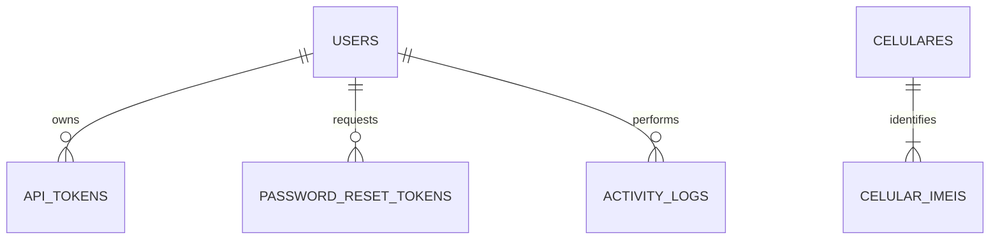

# Modelo relacional

La migración `001_catalog_and_security.sql` crea el esquema base en una base vacía o amplía la tabla `users` del CRUD existente. `bin/migrate.php` aplica los archivos SQL en orden y registra cada versión; la aplicación web nunca migra por sí sola.

## Relaciones principales

### `users`

Se conserva la tabla de usuarios del repositorio. El esquema base documenta `id VARCHAR(36)`, `name VARCHAR(120)`, `email VARCHAR(254)`, `password VARCHAR(255)`, `role VARCHAR(20)`, `status VARCHAR(20)` y marcas de tiempo. `email` tiene índice único. Al migrar una base previa se preservan las filas, se amplía `role` a texto para permitir los nuevos roles y se convierten `MEMBER` a `OPERADOR` y `REVIEWER` a `CONSULTA`.

Antes de migrar una base antigua, comprueba que `users` tenga las columnas que espera el repositorio y resuelve correos duplicados. La creación del índice único se detiene ante duplicados; la migración no elimina cuentas.

### `celulares` y `celular_imeis`

`celulares` almacena los 19 atributos escalares del ejercicio, más el ID y timestamps. El atributo de negocio `imei` se representa mediante filas en `celular_imeis`: `imei` es `VARCHAR(15)` y clave primaria, `celular_id` referencia el equipo y `sim_slot` identifica la posición. Un celular de una SIM tiene un IMEI; uno dual tiene dos IMEI distintos vinculados al mismo ID. No se serializan como CSV/JSON ni se convierten a número.

La unicidad global se aplica al identificador IMEI de cada ranura, porque el IMEI identifica un módem/slot individual; no se fuerza que cada equipo solo tenga un IMEI. El modelo valida el dígito Luhn y que el número de valores coincida con `cantidadSim`.

| Atributo | Columna/representación | Tipo y unidad |
|---|---|---|
| `marca` | `marca` | `VARCHAR(80)` |
| `imei` | `celular_imeis.imei` (relación) | texto de 15 dígitos; 1 o 2 valores |
| `pulgadas` | `pulgadas` | `DECIMAL(5,2)` pulgadas |
| `megapixeles` | `megapixeles` | `DECIMAL(7,2)` MP |
| `ram` | `ram` | `SMALLINT UNSIGNED` GB |
| `almacenamientoPrincipal` | `almacenamiento_principal` | `SMALLINT UNSIGNED` GB |
| `almacenamientoSecundario` | `almacenamiento_secundario` | `SMALLINT UNSIGNED` GB; cero significa no disponible |
| `sistemaOperativo` | `sistema_operativo` | `VARCHAR(80)` |
| `operador` | `operador` | `VARCHAR(80)` |
| `tecnologiaBanda` | `tecnologia_banda` | `VARCHAR(80)` |
| `wifi`, `bluetooth`, `nfc`, `huella`, `ir`, `resisteAgua` | columnas del mismo significado | `BOOLEAN` |
| `camaras` | `camaras` | `TINYINT UNSIGNED`, cantidad |
| `marcaCpu` | `marca_cpu` | `VARCHAR(80)` |
| `velocidadCpu` | `velocidad_cpu` | `DECIMAL(5,2)` GHz |
| `cantidadSim` | `cantidad_sim` | `TINYINT UNSIGNED`, 1 o 2 |

`ON DELETE CASCADE` elimina IMEI al eliminar el equipo. Los índices de marca, sistema operativo, operador y fecha soportan filtros, dashboard y orden más comunes.

### Seguridad y operación

- `password_reset_tokens`: digest SHA-256, usuario, expiración, fecha de uso. El token en claro solo se envía al usuario.
- `auth_rate_limits`: contador por clave HMAC de IP/cuenta y ventana temporal.
- `api_tokens`: digest del token aleatorio, usuario, etiqueta, vencimiento, revocación y último uso.
- `activity_logs`: usuario actor opcional, acción, recurso, ID y detalles JSON controlados (sin contraseñas ni tokens).
- `schema_migrations`: versión y fecha de aplicación.

La tabla `celular_imeis` y las actualizaciones del equipo se escriben en transacción. La auditoría web se registra después de la operación y es de mejor esfuerzo; si el registro falla, el cambio de negocio no se revierte. Para requisitos regulatorios se debe convertir a una escritura transaccional/outbox antes de producción.
